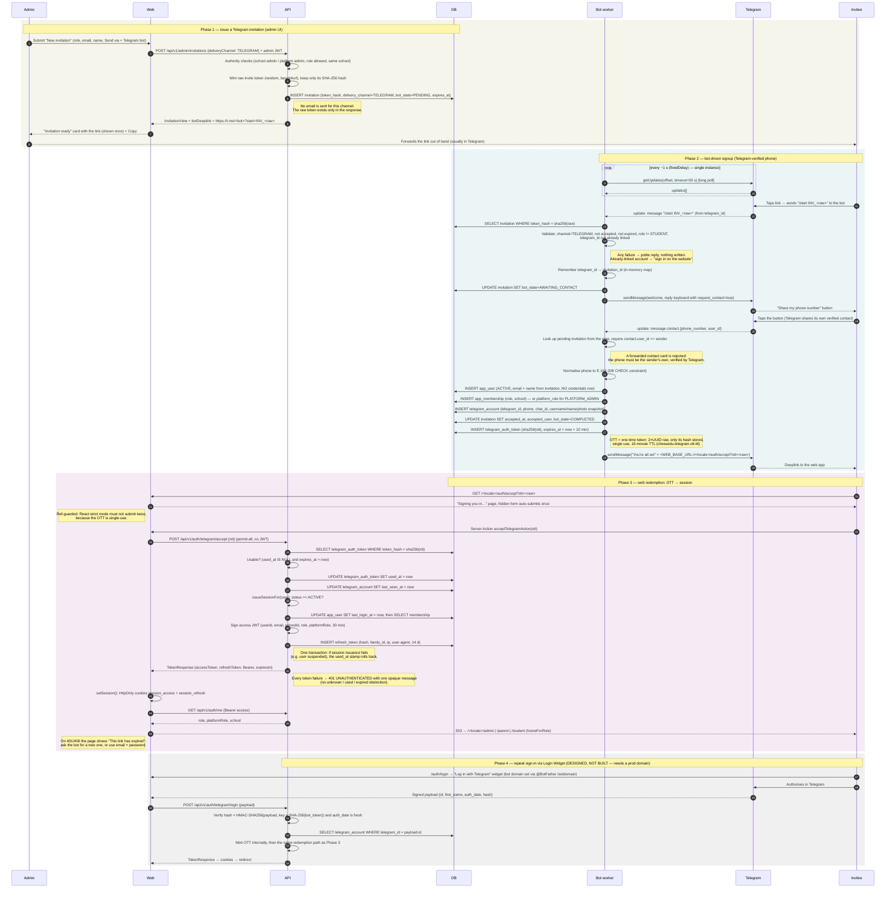

# Telegram authorization — how it works

Sequence of the Telegram-based signup + sign-in for non-student roles, as
implemented on `feature/telegram-auth-c` (slices A–D). Three phases are
live; the fourth (Login Widget) is designed but deferred until a
production domain exists.

Participants:

| Name | What it is |
|---|---|
| Admin | School admin in the web app |
| Web | Next.js server (Server Actions, HttpOnly cookies) — `apps/web` |
| API | Spring Boot backend — `apps/api`, port 7373 |
| DB | Postgres (`invitation`, `app_user`, `app_membership`, `telegram_account`, `telegram_auth_token`, `refresh_token`) |
| Bot worker | `TelegramBotWorker` + `TelegramSignupService`, a `@Scheduled` long-poll loop **inside** the API process (only when `chessedu.telegram.enabled=true`) |
| Telegram | Telegram Bot API (`api.telegram.org`) and the invitee's Telegram app |
| Invitee | The teacher / parent / admin being onboarded, in Telegram and then in a browser |

## Sequence diagram

## Step-by-step, with comments

### Phase 1 — Issue (admin)

1. **Admin picks "Send via: Telegram bot"** on `/<locale>/admin/invitations/new`.
   *Comment:* email is still required on the invitation — it becomes the user's login identity in `app_user`, even though no mail is sent.
2. **Web posts to `/api/v1/admin/invitations`** with the admin's JWT and `deliveryChannel: TELEGRAM`.
3. **API checks authority** (`enforceCallerAuthority`): school admins may invite SCHOOL_ADMIN / TEACHER / PARENT into their own school; STUDENT is refused on every channel; PLATFORM_ADMIN invites need a platform admin.
4. **API mints the invite token** and stores only its SHA-256 hash, with `bot_state = PENDING`. Also refuses if `chessedu.telegram.bot-username` is blank (400) — the deeplink can't be built.
5. **Response carries `botDeeplink`** once. The list endpoint never returns it; if the admin loses it they revoke and re-issue.
   *Comment:* the deeplink is deliberately returned in the action result, not round-tripped through a URL query, so the secret never lands in browser history or server logs.

### Phase 2 — Bot signup (Telegram)

6. **Bot worker long-polls** `getUpdates` in a `@Scheduled(fixedDelay)` loop, one HTTP call per cycle, read timeout = poll timeout + 15 s. Offset is in memory → single instance for now.
7. **`/start INV_<raw>` arrives.** The worker strips the `INV_` prefix, hashes the token, loads the invitation and validates: TELEGRAM channel, not accepted, not expired, non-student role, and that this `telegram_id` isn't already linked to a user.
   *Comment:* every failure has its own polite reply (uz / ru / en from the user's Telegram `language_code`), and nothing is written.
8. **Correlation is in memory.** A later "Share Contact" message carries no invite token, so a `ConcurrentHashMap<telegramId, invitationId>` remembers who is mid-signup. A backend restart loses it; the user simply re-runs `/start`.
9. **Bot asks for the phone** with a one-time reply keyboard (`request_contact: true`) and sets `bot_state = AWAITING_CONTACT`.
10. **Contact arrives.** The worker requires `contact.user_id == message.from.id` — a forwarded contact card is rejected. The number is Telegram-verified; it's normalised to E.164 to satisfy the DB CHECK.
11. **User is created without credentials.** `app_user` (ACTIVE), membership (or platform role), `telegram_account` (stable `telegram_id` as the key; username/name/photo are a mutable snapshot). Invitation becomes accepted with `bot_state = COMPLETED`.
12. **OTT is minted** (`TelegramAuthTokenService.mint`): raw = two UUIDs, hash stored, 10-minute TTL, single use. The bot replies with `<WEB_BASE_URL>/<locale>/auth/accept?ott=<raw>`.
    *Comment:* `/cancel` at any point sets `bot_state = CANCELLED` and clears the map entry; the admin list shows "Cancelled in the bot".

### Phase 3 — Web redemption

13. **Accept page** reads `?ott=`. A client form with the hidden token auto-submits exactly once (ref-guarded against React strict-mode double effects) to a Server Action — cookies can only be set from Server Actions/Route Handlers, not during render.
14. **`POST /api/v1/auth/telegram/accept`** is on the permit-all list. `TelegramAuthService.accept` runs in one transaction: redeem (find by hash → usable → stamp `used_at`), bump `telegram_account.last_seen_at`, then `AuthService.issueSessionFor`.
15. **Session issuance** mirrors password login minus the password: ACTIVE check, `last_login_at`, membership lookup, access JWT (30 min) + refresh token row (hash, family id, IP, User-Agent, 14 d).
    *Comment:* if issuance throws (user suspended after the bot minted the OTT) the whole transaction rolls back, so no used-but-unredeemed token row is left behind.
16. **Web installs HttpOnly cookies** (`session_access`, `session_refresh`), calls `/auth/me`, and redirects by role via the shared `homeForRole`: PARENT → `/parent`, STUDENT → `/student`, everything else → `/admin`.
17. **Failures are opaque.** Unknown, used, expired OTT and suspended user all return `401 UNAUTHENTICATED` with the same message; the page shows "This link has expired" and offers `/start` again or email + password.

### Phase 4 — Repeat sign-in (planned)

18. **Login Widget** on `/auth/login`, HMAC-verified against `SHA-256(bot_token)` with a fresh `auth_date`, keyed on `telegram_account.telegram_id`, mints an OTT internally and reuses Phase 3. Blocked on a production domain for `@BotFather /setdomain`.

## Security properties worth keeping

- **Only hashes at rest.** Invite token, OTT and refresh token are stored as SHA-256; plaintext lives only in the deeplink / response / cookie.
- **Phone is Telegram-verified**, never typed: the contact share is the proof, and it must be the sender's own.
- **Invitation-only**: no self-signup; the bot can't create a user without a valid, unexpired, unaccepted TELEGRAM-channel invitation.
- **One web entry point** (`/auth/accept` + `/auth/telegram/accept`) for both signup and the future widget login, so there is a single place to audit.
- **Public surface is small**: `/api/v1/auth/telegram/**` is the only permit-all addition; everything else stays behind the JWT.

## Known gap (not yet addressed)

A Telegram-signup user has **no password**, and the Login Widget isn't built yet. If their session cookies expire (14-day refresh) or they log out, there is currently no way back in: `/start` with their old invite says "already accepted", and `/start` from their linked account says "sign in on the website". Options until the widget lands: a bot command (e.g. `/login`) that mints a fresh OTT for an already-linked `telegram_id` and replies with a new `/auth/accept` link — small, reuses everything in Phase 3, and needs no domain. Worth deciding before Task E's runbook is written.
